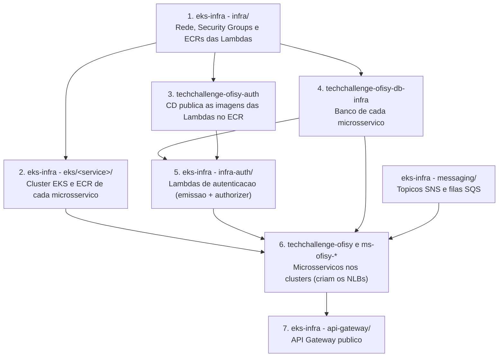

# Tech Challenge - Infraestrutura Kubernetes (AWS EKS & Redes via Terraform)

Repositório dedicado ao provisionamento infraestrutural base da aplicação **Ofisy** na AWS para o **Tech Challenge SOAT (FIAP)**, englobando a rede (VPC, Subnets, Internet Gateway, NAT Gateway), **um cluster Kubernetes (AWS EKS) por microsserviço**, os repositórios de imagens Docker (AWS ECR), as funções **AWS Lambda de autenticação de clientes** (emissão de token e validação) e o **API Gateway** público da aplicação.

O repositório contém camadas independentes, cada uma com seu próprio state do Terraform:

| Diretório | State | Conteúdo |
| :--- | :--- | :--- |
| `infra/` | `eks/terraform.tfstate` | Rede compartilhada, Security Groups e ECRs das Lambdas |
| `eks/<service>/` | `eks/<service>/terraform.tfstate` | Cluster EKS, node group, ECR e Datadog Agent de um microsserviço (`core`, `billing`, `stock`, `execution`, `notification`) |
| `infra-auth/` | `auth/terraform.tfstate` | Lambdas de autenticação de clientes (emissão de token e authorizer) |
| `api-gateway/` | `api-gateway/terraform.tfstate` | API Gateway público, integrado às Lambdas e ao NLB de cada microsserviço |
| `messaging/` | `messaging/terraform.tfstate` | Tópicos SNS e filas SQS FIFO usados na comunicação entre os microsserviços |

As cinco raízes `eks/<service>/` usam o mesmo módulo, `modules/eks/`, e só mudam o nome do serviço. Cada cluster tem seu próprio ciclo de vida: sobe e é destruído sem afetar os outros. É o mesmo padrão dos bancos no [techchallenge-ofisy-db-infra](https://github.com/15SOAT-FIAP/techchallenge-ofisy-db-infra).

A separação entre `infra/` e `infra-auth/` existe porque a Lambda depende do RDS do core, que é provisionado em [outro repositório](https://github.com/15SOAT-FIAP/techchallenge-ofisy-db-infra), e esse repo depende da rede criada aqui, manter tudo em um único state fecharia um ciclo entre os dois repositórios, impossibilitando o provisionamento a partir de uma conta vazia.

O `api-gateway/` é a última camada porque depende do **NLB de cada microsserviço**, que só existe depois que cada app já foi deployado no seu cluster, ou seja, depois de tudo o mais. Esses NLBs são **internos** (sem IP público) - o API Gateway alcança eles via **VPC Link**, e é o único ponto de entrada público de toda a aplicação.

---

## Propósito do Repositório

Isolar e automatizar o provisionamento da infraestrutura de computação em nuvem necessária para suportar a aplicação principal e o banco de dados relacional, além de expor publicamente essa aplicação através de um **API Gateway** que protege, com autenticação via CPF/CNPJ, as rotas pensadas para o cliente final (consulta de status, notificações da própria ordem de serviço e aprovação/reprovação de orçamento). Com o NLB do EKS interno, o Gateway é o **único ponto de entrada público** de toda a aplicação.

---

## Tecnologias Utilizadas

- **Terraform (`>= 1.5.0`)**: Infraestrutura como Código (IaC).
- **AWS EKS (Elastic Kubernetes Service)**: Um cluster Kubernetes gerenciado por microsserviço (`ms-ofisy-<service>-cluster`), cada um com um node group `t3.medium` de 1 node (o `max_size` é 2, mas não há Cluster Autoscaler para escalar sozinho).
- **AWS VPC & Networking**: Subnets públicas/privadas, Internet Gateway, NAT Gateway e Tabela de Roteamento, compartilhados por todos os clusters.
- **AWS ECR (Elastic Container Registry)**: Registros privados de imagens de container - `ms-ofisy-<service>-ecr` (um por microsserviço), `ofisy-auth` (Lambda de emissão de token) e `ofisy-auth-authorizer` (Lambda Authorizer).
- **AWS Lambda**: Duas funções, empacotadas como imagem de container `arm64`. A de emissão de token roda dentro da VPC (consulta o Postgres); a Authorizer roda fora da VPC (só valida assinatura e expiração do token, sem acessar banco).
- **AWS API Gateway (HTTP API)**: Porta de entrada pública da aplicação - expõe `POST /auth/customers` e repassa as demais rotas para o cluster de cada microsserviço via VPC Link.
- **AWS VPC Link**: permite o API Gateway (que roda fora da VPC) alcançar os NLBs internos na subnet privada. Sem ele, o Gateway não teria como chegar num NLB sem IP público.
- **AWS Lambda Authorizer**: valida o token JWT (HS256) nas rotas protegidas do Gateway (status, notificações de OS e aprovação/reprovação de orçamento). Necessário porque o JWT Authorizer nativo do API Gateway só verifica assinatura assimétrica via JWKS, e este token usa segredo simétrico.
- **AWS SNS & SQS (FIFO)**: Mensageria entre os microsserviços. Os serviços publicadores têm um tópico próprio, e cada serviço consome de uma fila com DLQ, recebendo só os eventos que lhe interessam.
- **AWS IAM**: Gerenciamento de papéis de execução para cluster, worker nodes e Lambdas (compatível com AWS Academy / `LabRole`).
- **GitHub Actions**: Pipeline automatizada de CI/CD para deploy e destruição da infraestrutura.

---

## Arquitetura de Rede e EKS

```text
AWS Cloud (us-east-1)
 └── VPC (10.0.0.0/16)
      ├── Internet Gateway (IGW) & NAT Gateway (com Elastic IP)
      ├── Subnet Pública A (10.0.1.0/24 - us-east-1a)
      ├── Subnet Pública B (10.0.4.0/24 - us-east-1b)
      ├── Subnet Privada A (10.0.2.0/24 - us-east-1a) ── [Worker Nodes dos 5 clusters / Pods / Lambda de auth / NLBs internos / VPC Link]
      └── Subnet Privada B (10.0.3.0/24 - us-east-1b) ── [Worker Nodes dos 5 clusters / Pods / Lambda de auth / NLBs internos / VPC Link]
```

Os cinco clusters dividem a mesma VPC, as mesmas subnets e o mesmo NAT Gateway. Os NLBs dos microsserviços são internos (sem IP público), só são alcançáveis de dentro da VPC. O API Gateway, que roda fora da VPC, chega até eles através de um único VPC Link (ENIs provisionadas nas subnets privadas acima). A Lambda Authorizer não aparece nesse diagrama porque não roda dentro da VPC.

---

## Ordem de Execução entre os Repositórios

A infraestrutura está distribuída em vários repositórios que se conectam por **Data Sources** (busca por tag ou por nome). Nunca por referência direta de recurso (remote state). Isso significa que a ordem abaixo precisa ser respeitada: cada etapa só encontra o que a anterior criou.



Cada etapa só pode rodar depois que as anteriores terminaram. A tabela abaixo detalha o que precisa existir em cada uma:

| Etapa | Precisa que já exista |
| :--- | :--- |
| **1** | Nada além da conta AWS e dos secrets configurados |
| **2** | VPC, subnets e o SG `ofisy-eks-sg` da etapa 1 |
| **3** | Os repositórios ECR `ofisy-auth` e `ofisy-auth-authorizer`, vazios, criados na etapa 1 |
| **4** | VPC, subnets privadas e o SG da Lambda, da etapa 1. O RDS libera a porta 5432 para o CIDR da VPC, então não depende dos clusters |
| **5** | O banco do core (etapa 4), as imagens da etapa 3 e os Security Groups da etapa 1 |
| **6** | O cluster e o ECR do serviço (etapa 2) e o banco dele (etapa 4) |
| **7** | As duas funções Lambda da etapa 5 e os NLBs (internos) dos microsserviços listados em `nlb_service_names`, criados na etapa 6 |

As etapas **2, 3 e 4 não dependem umas das outras** e podem rodar em paralelo depois da etapa 1. Dentro das etapas 2, 4 e 6, cada microsserviço é independente dos outros.

A **mensageria** (`messaging/`) não depende de nenhuma outra camada, nem da rede, e pode rodar a qualquer momento. Ela só precisa existir antes da etapa 6, porque os microsserviços não sobem sem a fila que consomem.

Para **destruir**, percorra o caminho inverso: API Gateway → microsserviços → mensageria → Lambdas → bancos → clusters → rede. Destruir a rede antes das Lambdas deixa recursos órfãos, porque as ENIs da Lambda de emissão de token ficam presas às subnets. Destrua o Gateway antes das Lambdas para evitar rotas apontando pra funções que não existem mais.

### Contrato entre os repositórios

Como não há referência direta entre states, o que liga as camadas são **nomes e tags**. Renomear qualquer item desta tabela quebra o `apply` do repositório vizinho:

| Recurso | Identificador | Criado por | Lido por |
| :--- | :--- | :--- | :--- |
| VPC | tag `ofisy-vpc` | `infra/` | `eks/*`, db-infra, `infra-auth/`, `api-gateway/` |
| Subnets públicas | tag `ofisy-public-subnet-*` | `infra/` | `eks/*` |
| Subnets privadas | tag `ofisy-private-subnet-*` | `infra/` | `eks/*`, db-infra, `infra-auth/`, `api-gateway/` |
| SG do EKS | tag `ofisy-eks-sg` | `infra/` | `eks/*`, `api-gateway/` |
| SG da Lambda (emissão de token) | tag `ofisy-lambda-auth-sg` | `infra/` | db-infra, `infra-auth/` |
| ECR da Lambda (emissão de token) | `ofisy-auth` | `infra/` | CD do repo de autenticação, `infra-auth/` |
| ECR da Lambda (authorizer) | `ofisy-auth-authorizer` | `infra/` | CD do repo de autenticação, `infra-auth/` |
| Cluster EKS de cada serviço | `ms-ofisy-<service>-cluster` | `eks/<service>/` | CD de cada microsserviço |
| ECR de cada serviço | `ms-ofisy-<service>-ecr` | `eks/<service>/` | CD de cada microsserviço |
| Instância RDS do core | identifier `ms-ofisy-core-db` | db-infra | `infra-auth/` |
| Função Lambda (emissão de token) | `ofisy-auth` | `infra-auth/` | `api-gateway/` |
| Função Lambda (authorizer) | `ofisy-auth-authorizer` | `infra-auth/` | `api-gateway/` |
| NLB do core (interno) | tag `kubernetes.io/service-name` = `default/ofisy-service` | `techchallenge-ofisy` (Service do k8s) | `api-gateway/` |
| NLB dos demais serviços (interno, quando forem extraídos do core) | tag `kubernetes.io/service-name` = `default/ms-ofisy-<service>-service` | `ms-ofisy-<service>` (Service do k8s) | `api-gateway/` |
| Tópico SNS de cada serviço publicador | `ofisy-<service>-events.fifo` | `messaging/` | Cada microsserviço (publica pelo nome) |
| Fila SQS de cada serviço consumidor | `ofisy-<service>.fifo` | `messaging/` | Cada microsserviço (consome pelo nome) |

O Security Group da Lambda é criado em `infra/`, e não junto da função, justamente para que o db-infra consiga liberar a porta 5432 a partir dele sem depender do state da Lambda.

---

## Mensageria (SNS/SQS)

Os microsserviços conversam por eventos. Os serviços publicadores têm um tópico SNS FIFO próprio, e cada serviço consome de uma única fila SQS FIFO. O tópico e a fila `service-order` são do core. As assinaturas filtram pelo campo `type` do envelope, então cada fila recebe só os eventos de que o seu serviço precisa. Depois de 5 recebimentos sem sucesso, a mensagem vai para a DLQ da fila (`ofisy-<service>-dlq.fifo`).

| Tópico | Fila | Eventos |
| :--- | :--- | :--- |
| `ofisy-service-order-events.fifo` | `ofisy-execution.fifo` | `ServiceOrderCancelled` |
| `ofisy-service-order-events.fifo` | `ofisy-notification.fifo` | `ServiceOrderFinished` |
| `ofisy-billing-events.fifo` | `ofisy-stock.fifo` | `QuoteCreated`, `QuoteUpdated`, `QuoteReproved` |
| `ofisy-billing-events.fifo` | `ofisy-service-order.fifo` | `QuoteSentForApproval`, `QuoteApproved`, `PaymentConfirmed`, `QuoteCancelled` |
| `ofisy-billing-events.fifo` | `ofisy-notification.fifo` | `QuoteSentForApproval`, `PaymentConfirmed` |
| `ofisy-billing-events.fifo` | `ofisy-execution.fifo` | `QuoteApproved` |
| `ofisy-stock-events.fifo` | `ofisy-billing.fifo` | `StockConsumed`, `StockConsumptionFailed` |
| `ofisy-stock-events.fifo` | `ofisy-notification.fifo` | `StockLow` |
| `ofisy-stock-events.fifo` | `ofisy-service-order.fifo` | `StockRefunded` |
| `ofisy-execution-events.fifo` | `ofisy-service-order.fifo` | `ExecutionStarted`, `AllExecutionsCompleted` |
| `ofisy-execution-events.fifo` | `ofisy-stock.fifo` | `AllExecutionsCancelled` |

O roteamento fica no mapa `subscriptions` de `messaging/main.tf`.

Para a entrega funcionar, todo publicador precisa seguir o mesmo contrato:

- O corpo da mensagem é o envelope `{ eventId, type, serviceOrderId, occurredAt, payload }`, e o filtro das assinaturas lê o `type` dele.
- Todo publish informa um `MessageGroupId` (o `serviceOrderId`), que garante a ordem dos eventos de uma mesma OS.
- As assinaturas usam *raw delivery*, então o consumidor recebe o envelope como foi publicado, sem o invólucro do SNS.

---

## Observabilidade (Datadog Agent)

Cada `eks/<service>/` também provisiona o **Datadog Agent** no seu cluster via Helm (`helm_release.datadog`, chart `datadog/datadog`, em `modules/eks/datadog.tf`), usando o provider `helm` do Terraform autenticado contra o próprio cluster criado na mesma execução (`aws_eks_cluster_auth`). No Datadog, cada cluster aparece com o próprio nome (`ms-ofisy-<service>-cluster`).

O Agent roda como DaemonSet (um pod por node) mais o Cluster Agent, coletando métricas de CPU e memória de nodes e pods via kubelet/kube-state-metrics. Logs (JSON estruturado, com correlação de requisições) e APM (via hostPort TCP 8126) ficam habilitados; o Process Agent continua desativado para manter o footprint baixo nos nodes `t3.medium`. A correlação entre logs e traces e o envio de spans de latência das APIs dependem da instrumentação da aplicação (`dd-trace-java`) no repositório `techchallenge-ofisy`.

Alertas (`datadog_monitor`) não são gerenciados por Terraform neste repositório, são criados manualmente na UI do Datadog. Healthcheck/uptime é a única exceção - ver seção abaixo.

Variáveis relevantes (`eks/<service>/variables.tf`):

| Variável          | Descrição                                                               |
| :---------------- | :----------------------------------------------------------------------- |
| `datadog_api_key` | API Key do Datadog (sensível). Nas pipelines vem do secret `DD_API_KEY` |
| `datadog_site`    | Site do Datadog (padrão: `us5.datadoghq.com`)                           |

Para execução local, passe essas variáveis via `TF_VAR_*` (veja a Opção B em "Como Executar").

### Uptime (Synthetics)

Diferente do Agent (que só enxerga o que está dentro do cluster), o uptime público é monitorado de **fora da AWS** via `datadog_synthetics_test`, provisionado em **`api-gateway/`** (não em `infra/`) - essa camada é quem já tem, nativamente, a URL pública (`aws_apigatewayv2_stage.default.invoke_url`), sem precisar passar variável manual entre states.

O teste bate a cada 5 minutos em `<invoke_url>/actuator/health` (rota `ANY /{proxy+}`, que vai pro core, sem autenticação) e valida status HTTP 200, cobrindo a cadeia inteira: API Gateway → VPC Link → NLB → Service (k8s) → Pod → Actuator.

Variáveis relevantes (`api-gateway/variables.tf`): `datadog_api_key`, `datadog_app_key` (Application Key, diferente da API Key - necessária pro provider gerenciar recursos via API) e `datadog_site`.

---

## API Gateway (validação via CPF/CNPJ)

O `api-gateway/` expõe `POST /auth/customers` (repassando para a Lambda de emissão de token) e valida, através de um **Lambda Authorizer**, todas as rotas pensadas para o cliente final:

- `GET /api/v1/service-orders/{id}/status`
- `PATCH /api/v1/service-orders/quote/{id}/approve`
- `PATCH /api/v1/service-orders/quote/{id}/reprove`
- `GET /api/v1/notifications/service-orders` (+ `/unread`, `/{id}`, `PATCH /{id}/read`)

Todas usam o **mesmo** `aws_apigatewayv2_authorizer` (`customers_token`) - um authorizer não é exclusivo de uma rota, então nenhuma Lambda ou permissão extra é criada por rota.

As notificações de **estoque** (`/api/v1/notifications/stock/*`) ficam de fora de propósito: são operação interna de staff (papel `STOCKMAN`), resolvida dentro do app via JWT de staff - não fazem parte da jornada do cliente final. As demais rotas (login, admin, swagger etc.) também continuam sendo só repassadas pelo Gateway, sem essa camada extra.

### Roteamento por microsserviço

O Gateway tem uma integração por NLB de microsserviço (`var.nlb_service_names`), e as rotas ficam num único map, `local.service_routes` em `api-gateway/main.tf`, que liga cada rota ao serviço que a atende e diz se ela exige o token do cliente.

Hoje só o **core** está no map: os microsserviços ainda não têm Service/NLB nem expõem todas as rotas que hoje vivem no core, e o `plan` do Gateway falha se um NLB listado não existir. Quando um serviço for extraído do core:

1. adicione `<service> = "default/ms-ofisy-<service>-service"` em `nlb_service_names`;
2. aponte as rotas dele para o serviço no `service_routes` (ex.: `"ANY /api/v1/stocks/{proxy+}" = { service = "stock", protected = false }`).

### Por que um Lambda Authorizer

O HTTP API do lab não valida JWT nativamente quando a assinatura é simétrica (HS256) - o "JWT Authorizer" nativo da AWS só verifica assinatura assimétrica, via um endpoint JWKS. Como a Lambda de auth assina o token com HS256, a validação precisa passar por uma Lambda Authorizer própria.

### NLB interno + VPC Link

Os NLBs dos microsserviços são **internos** (sem IP público), e o único ponto de entrada público de toda a aplicação passa a ser o próprio API Gateway. Como o Gateway roda fora da VPC, ele alcança os NLBs através de um único `aws_apigatewayv2_vpc_link`, com ENIs provisionadas nas subnets privadas.

Uma NLB opera na camada 4 (TCP puro) e não entende path de URL. Por isso a integração via VPC Link (`connection_type = "VPC_LINK"`) aponta pro **ARN do Listener** da NLB, não pra uma URL com path embutido. Consequência direta: existe **uma integração por microsserviço** (`nlb_proxy["<service>"]`), compartilhada por todas as rotas daquele serviço. O path original da requisição passa direto, e quem diferencia cada rota é só o serviço de destino e a presença (ou não) de `authorization_type`/`authorizer_id`.

Os NLBs são criados pelo Kubernetes (não pelo Terraform), a partir do `Service` `type: LoadBalancer` definido no `k8s/service.yml` de cada microsserviço. Mesmo assim o ARN do Listener **não precisa ser informado manualmente**: o cloud provider grava no Load Balancer a tag `kubernetes.io/service-name` com o valor `namespace/nome` do Service, e o module descobre cada Listener a partir dela:

```hcl
data "aws_lb" "service" {
  for_each = var.nlb_service_names # hoje: core = "default/ofisy-service"

  tags = {
    "kubernetes.io/service-name" = each.value
  }
}

data "aws_lb_listener" "service" {
  for_each = var.nlb_service_names

  load_balancer_arn = data.aws_lb.service[each.key].arn
  port              = var.nlb_listener_port # default: 8080
}
```

O Service de cada microsserviço precisa expor a porta **8080**, mesmo que o container escute em outra (o notification usa `targetPort: 8081`).

O trade-off é de ordenação: o `plan` do `api-gateway/` falha (em vez de só o `apply`) enquanto qualquer microsserviço listado em `nlb_service_names` ainda não tiver sido deployado, porque sem o `Service` não existe NLB a descobrir.

**Pendência conhecida**: o header `X-Customer-Id` (usado para filtrar notificações de OS por cliente) não é mais injetado pela integração - decisão de escopo, não esquecimento. Enquanto isso não for retomado, as 4 rotas de `/api/v1/notifications/service-orders/*` respondem `400` (o controller do app exige esse header).

### Observação sobre a validação

A validação do token acontece **só no Gateway** (Lambda Authorizer) - o app Spring Boot (`techchallenge-ofisy`) não valida esse token; todas as rotas acima continuam nos `public-paths` dele. Isso deixou de ser um problema de segurança a partir do momento em que o NLB ficou interno: não existe mais nenhum caminho de acesso à aplicação que não passe pelo Gateway.

---

## Configuração de Secrets no GitHub

Os secrets são definidos como **Organization Secrets** na org `15SOAT-FIAP`, de modo que todos os repositórios compartilhem a mesma definição. As credenciais do AWS Academy expiram a cada sessão de laboratório, e centralizadas basta rotacioná-las em um único lugar.

| Secret | Descrição |
| :--- | :--- |
| `AWS_ACCESS_KEY_ID` | Chave de acesso AWS |
| `AWS_SECRET_ACCESS_KEY` | Chave secreta AWS |
| `AWS_SESSION_TOKEN` | Token da sessão AWS (obrigatório para AWS Academy) |
| `AWS_ACCOUNT_ID` | ID da conta AWS |
| `DB_PASSWORD` | Senha do PostgreSQL, a mesma para todos os bancos. Definida pelo db-infra e consumida pela Lambda de emissão de token e pelos microsserviços |
| `JWT_SECRET` | Segredo de assinatura do JWT. Precisa ser idêntico entre a Lambda que assina (emissão de token) e a Lambda que valida (authorizer) - o app Spring Boot não participa mais dessa validação |
| `DD_API_KEY`            | API Key do Datadog, usada pelo Datadog Agent instalado em cada cluster EKS para enviar métricas          |
| `DD_APP_KEY`            | Application Key do Datadog, usada pelo provider Terraform em `api-gateway/` para gerenciar o Synthetics Test de uptime |

O `api-gateway/` não usa secret adicional além de `DD_API_KEY`/`DD_APP_KEY`: os demais valores que variam (`auth_lambda_name`, `auth_authorizer_lambda_name`) são informados como input do `workflow_dispatch`, não como secret. O Listener do NLB é descoberto via `data source`, então não é input nem secret.

---

## Como Executar

### Opção A: Execução via GitHub Actions (Recomendado)

1. Vá até a aba **Actions** do repositório no GitHub.
2. Selecione a pipeline **`Deploy Rede (Terraform)`** e clique em **Run workflow**, escolhendo a branch desejada. Esta é a **etapa 1** do fluxo.
3. Selecione **`Deploy Clusters EKS (Terraform)`** e escolha em `service` o cluster a provisionar (`all` sobe os cinco em paralelo). Esta é a **etapa 2**.
4. Depois que os bancos e as imagens das Lambdas estiverem prontos (etapas 3 e 4), selecione **`Deploy Lambda de Autenticação (Terraform)`** e clique em **Run workflow**, informando em `image_tag` e `authorizer_image_tag` os SHAs dos commits publicados no ECR pelo CD do repositório de autenticação. Esta é a **etapa 5**.
5. Depois que os microsserviços listados em `nlb_service_names` tiverem sido deployados nos seus clusters (etapa 6, cria os NLBs internos), selecione **`Deploy API Gateway (Terraform)`**, informando:
   - `auth_lambda_name`: nome da função de emissão de token (padrão `ofisy-auth`)
   - `auth_authorizer_lambda_name`: nome da função authorizer (padrão `ofisy-auth-authorizer`)

   Esta é a **etapa 7**, a última do fluxo.

A pipeline **`Deploy Mensageria SNS/SQS (Terraform)`** não tem inputs.

A pipeline da Lambda verifica se a imagem existe no ECR antes de rodar o Terraform, e falha com uma mensagem explícita caso a etapa 3 ainda não tenha sido concluída.

Os workflows **`Destruir API Gateway`**, **`Destruir Lambda de Autenticação`**, **`Destruir Clusters EKS`** e **`Destruir Rede`** fazem o caminho inverso: destrua sempre o Gateway primeiro, depois a Lambda, depois os bancos (no db-infra), depois os clusters e por último a rede. O destroy dos clusters também aceita `service`, para derrubar um só. Antes do `terraform destroy`, ele apaga os Services `LoadBalancer` do cluster, porque os NLBs são criados pelo Kubernetes, fora do Terraform. Sem isso, eles ficariam órfãos e travariam o destroy da rede. O **`Destruir Mensageria SNS/SQS`** é independente e pode rodar depois que os microsserviços saírem do ar.

Todos os destroys terminam com sucesso sem fazer nada quando o state da camada já está vazio, então podem ser executados de novo sem quebrar.

#### Orquestração pelo ofisy-platform

Além do `workflow_dispatch`, os workflows de deploy e destroy aceitam `workflow_call`, e o repositório [ofisy-platform](https://github.com/15SOAT-FIAP/ofisy-platform) os chama em sequência pelo `up.yml` (sobe o ambiente) e pelo `down.yml` (destrói), seguindo a ordem de execução descrita acima. Os secrets chegam por `secrets: inherit`. Os inputs são os mesmos do disparo manual:

| Workflow | Inputs |
| :--- | :--- |
| `deploy-eks.yml`, `destroy-eks.yml` | `service` (padrão `all`) |
| `deploy-auth-lambda.yml` | `image_tag` e `authorizer_image_tag` (obrigatórios) |
| `deploy-api-gateway.yml`, `destroy-api-gateway.yml` | `auth_lambda_name` (padrão `ofisy-auth`) e `auth_authorizer_lambda_name` (padrão `ofisy-auth-authorizer`) |
| Demais | Nenhum |

Quando chamado de outro repositório, o checkout usa a branch padrão (`master`) deste repositório.

---

### Opção B: Execução Local via CLI

#### 1. Pré-requisitos

- AWS CLI configurado (`aws configure`).
- Terraform `v1.5.0` ou superior instalado.

#### 2. Rede (`infra/`)

```bash
cd infra

cp backend.hcl.example backend.hcl
# Preencha o account_id no nome do bucket do backend.hcl

terraform init -backend-config=backend.hcl
terraform plan
terraform apply -auto-approve
```

#### 3. Clusters (`eks/<service>/`)

Repita para cada serviço (`core`, `billing`, `stock`, `execution`, `notification`):

```bash
cd eks/core

export TF_VAR_account_id=<account_id>
export TF_VAR_datadog_api_key=<datadog_api_key>
# No AWS Academy, se existirem, informe também as roles do EKS:
# export TF_VAR_eks_cluster_role=<LabEksClusterRole...>
# export TF_VAR_eks_node_role=<LabEksNodeRole...>

terraform init \
  -backend-config="bucket=ofisy-tfstate-<account_id>" \
  -backend-config="key=eks/core/terraform.tfstate" \
  -backend-config="region=us-east-1"
terraform plan
terraform apply -auto-approve
```

#### 4. Camada das Lambdas (`infra-auth/`)

Execute somente após o RDS do core estar provisionado e as imagens `ofisy-auth:<sha>` e `ofisy-auth-authorizer:<sha>` publicadas no ECR:

```bash
cd infra-auth

cp terraform.tfvars.example terraform.tfvars
cp backend.hcl.example backend.hcl

# Preencha account_id, image_tag, authorizer_image_tag, db_password
# e jwt_secret no terraform.tfvars, e o account_id no backend.hcl
# (a key deve ser auth/terraform.tfstate)

terraform init -backend-config=backend.hcl
terraform plan
terraform apply -auto-approve
```

O deploy de código das Lambdas **não passa pelo Terraform**: o campo `image_uri` está sob `ignore_changes` nas duas funções, e o CD do repositório de autenticação atualiza cada uma com `aws lambda update-function-code`. O `image_tag`/`authorizer_image_tag` aqui só definem com qual imagem a função é criada da primeira vez.

#### 5. Camada do API Gateway (`api-gateway/`)

Execute somente após as duas Lambdas existirem e os microsserviços listados em `nlb_service_names` já terem sido deployados nos seus clusters (para os NLBs internos existirem):

```bash
cd api-gateway

cp terraform.tfvars.example terraform.tfvars
cp backend.hcl.example backend.hcl

# Preencha auth_lambda_name e auth_authorizer_lambda_name no
# terraform.tfvars, e o bucket no backend.hcl (a key deve ser
# api-gateway/terraform.tfstate). Os Listeners dos NLBs são
# descobertos automaticamente via data source.

terraform init -backend-config=backend.hcl
terraform plan
terraform apply -auto-approve

# URL pública final:
terraform output api_gateway_invoke_url
```

#### 6. Mensageria (`messaging/`)

Antes do deploy dos microsserviços:

```bash
cd messaging

cp backend.hcl.example backend.hcl
# Preencha o account_id no nome do bucket do backend.hcl

terraform init -backend-config=backend.hcl
terraform plan
terraform apply -auto-approve

# ARNs dos tópicos e URLs das filas:
terraform output
```

---

## Repositórios Relacionados

1. **[Serverless Function (Lambda)](https://github.com/15SOAT-FIAP/techchallenge-ofisy-auth)** - Autenticação de clientes via CPF/CNPJ, geração de JWT token e validação desse token (Lambda Authorizer). O código vive lá; a infraestrutura das duas funções é provisionada aqui, em `infra-auth/`.
2. **[Infraestrutura EKS (Este repositório)](https://github.com/15SOAT-FIAP/techchallenge-ofisy-eks-infra)** - VPC, um cluster EKS por microsserviço, ECRs, Lambdas de autenticação e API Gateway.
3. **[Infraestrutura de Bancos](https://github.com/15SOAT-FIAP/techchallenge-ofisy-db-infra)** - Um banco por microsserviço (RDS PostgreSQL e DynamoDB), cada um com state próprio.
4. **[Core em Kubernetes](https://github.com/15SOAT-FIAP/techchallenge-ofisy)** - Aplicação Spring Boot do core, Dockerfile, manifestos Kubernetes (`k8s/`) e CD.
5. **Microsserviços** - [`ms-ofisy-billing`](https://github.com/15SOAT-FIAP/ms-ofisy-billing), [`ms-ofisy-stock`](https://github.com/15SOAT-FIAP/ms-ofisy-stock), [`ms-ofisy-execution`](https://github.com/15SOAT-FIAP/ms-ofisy-execution) e [`ms-ofisy-notification`](https://github.com/15SOAT-FIAP/ms-ofisy-notification).